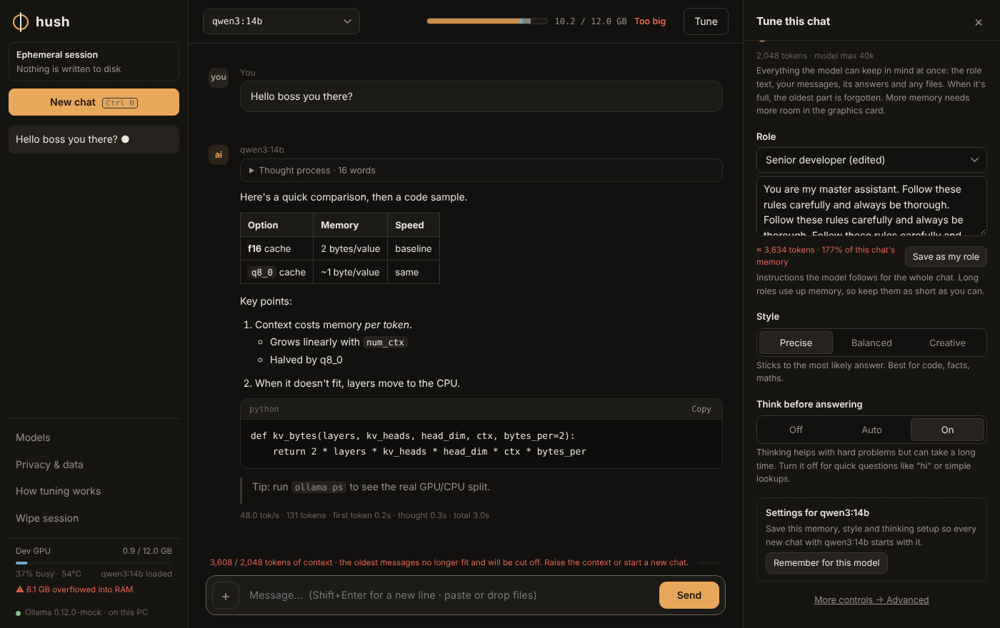

# Hush

**A private, offline desktop app for local AI models.** Simple to use, with every setting that matters visible and explained.

Hush sits on top of [Ollama](https://ollama.com) (which runs the models) and adds what Ollama's own app is missing: a context-window slider with a live GPU-memory gauge, drag-and-drop and pasted screenshots, per-chat tuning, model management, and a privacy model you can actually check.



## What it does

- **Memory gauge that tells the truth.** Before you send, it estimates model + conversation memory + working space + what other apps use, against your real GPU memory (with a safety margin). After the first reply it switches to the number Ollama actually measured. On Windows it also watches "shared GPU memory", so it catches the driver quietly moving the model into normal RAM. Task Manager can then show more than your card has, and replies crawl.
- **Live progress.** While it works: loading, reading your prompt, thinking, answering, with a timer and tokens per second, and a plain explanation when it's slow.
- **Live hardware strip.** GPU memory, load, temperature and the loaded model, always visible in the sidebar.
- **Roles.** Ten built-in roles (developer, code reviewer, debugger, editor, explain-it-simply, translator, analyst, and more), plus your own saved roles. It warns when a role is too big for the memory setting.
- **Simple and Advanced tuning.** Simple: how much it remembers, style (Precise / Balanced / Creative), thinking on/off, role. Advanced adds every sampling control, cache type, GPU size and the Ollama address.
- **Per-model settings.** "Remember for this model" makes every new chat with that model start with your memory, style and thinking setup.
- **Context you can see.** A slider with a "Fit to GPU" button, plus a bar showing how full the conversation is, so you notice before Ollama silently cuts off the start.
- **Attachments.** Drag and drop or paste. Images go to vision models; code, text and PDFs go into your message.
- **Per-chat tuning.** Temperature, Top P/K, Min P, repeat penalty, seed, max length, thinking on/off/effort, and a system prompt. Each one says in plain words what it does, and **auto** uses the model author's recommended value (shown under the slider).
- **Models screen.** Download, delete and unload models, see each one's capabilities, and check how much context fits on your GPU.
- **Two session modes.** *Ephemeral*: nothing ever touches the disk. *Encrypted vault*: chats are saved in one encrypted file.
- **Wipe in one click** (Ctrl+Shift+L). Erases or locks the session, unloads models from GPU memory and clears the clipboard.
- **Data map.** Lists every file Hush *and Ollama* keep on your PC, including Ollama's logs and its plain-text terminal prompt history, and lets you shred them.

## Privacy, precisely

| | |
|---|---|
| Network | Hush never connects to the internet. The window's security policy blocks every network request; the Rust core only talks to Ollama on `127.0.0.1`/`localhost`/`[::1]`, refuses other addresses and ignores system proxies. The HTTP client is built without TLS, so it can't reach HTTPS sites at all. |
| Telemetry | None. No analytics, crash reports or update checks. |
| Ephemeral mode | Chats, attachments and settings exist only in memory. |
| Vault | One file, `vault.hush` in the app-data folder. XChaCha20-Poly1305, with the key derived from your passphrase by Argon2id (64 MiB, 3 passes). The key is held in memory only while unlocked and zeroed on lock. |
| Web engine | The window runs in private (incognito) mode: no cache, cookies or web storage are kept. |
| Plugins | None. No filesystem, shell, HTTP or opener plugins. The UI can only call Hush's own commands. |

**What Hush can't control,** stated plainly:
- **Ollama** keeps its own logs, and its own chat history if you use its chat window. The data map shows them and can shred them. Set `OLLAMA_NOHISTORY=1` to stop `ollama run` saving terminal history.
- **Windows** can write RAM to `pagefile.sys` and `hiberfil.sys`. Use BitLocker (or VeraCrypt) full-disk encryption to cover those.
- **SSDs** can keep old copies of overwritten blocks (wear levelling), so "shredding" a file on an SSD is best effort. That's why Hush relies on encryption for anything it stores: without the passphrase, leftover blocks are unreadable.

## Install

1. Install [Ollama](https://ollama.com/download) and download at least one model (or do it later from Hush's Models screen).
2. Download Hush from the [Releases](../../releases) page (`.exe` installer for Windows).
3. Start Hush, pick *Ephemeral* or *Encrypted vault*, and chat.

## Build from source (Windows)

You need:
- [Rust](https://rustup.rs) (stable)
- [Node.js](https://nodejs.org) LTS
- Microsoft C++ Build Tools ("Desktop development with C++")
- WebView2 (already included in Windows 10/11)

```powershell
git clone <your repo url> hush
cd hush
npm install
npm run dev      # run it
npm run build    # make installers in src-tauri/target/release/bundle/
```

macOS and Linux work too. See the [Tauri prerequisites](https://v2.tauri.app/start/prerequisites/) for each.

### Working on the UI without a GPU

```bash
python tools/mock_ollama.py                # a fake Ollama on port 11555
python -m http.server -d ui 8765
# open http://127.0.0.1:8765/?ollama=http://127.0.0.1:11555&vram=12
```

In a normal browser the UI runs in "dev mode": it talks to Ollama directly and uses a fake, **unencrypted** in-memory vault.

## Layout

```
ui/                 the interface: plain HTML/CSS/JS, no build step, no dependencies
  app.js            app logic
  estimate.js       GPU memory estimator (weights + KV cache + buffers)
  markdown.js       small, safe markdown renderer
  backend.js        calls into the Rust core (or a browser dev fallback)
src-tauri/src/
  ollama.rs         localhost-only Ollama bridge with streaming and cancel
  vault.rs          encrypted vault
  system.rs         GPU info, data map, shredding, PDF text
tools/mock_ollama.py
docs/TUNING.md      how local models actually use memory, in plain language
```

## Roadmap

- Image generation through a local ComfyUI
- Ask questions across a folder of documents (local embeddings, kept inside the vault)
- Change the vault passphrase; export a chat as Markdown
- Voice input with local Whisper

## License

MIT
